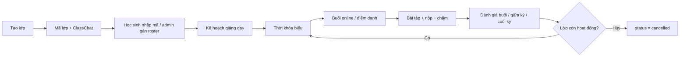
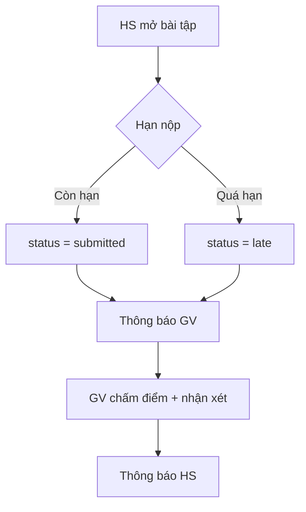

# Sơ đồ khối (FlowChart)

Mô tả luồng chính từ khi người dùng mở EduFlow đến khi hoàn thành một phiên học/giảng.

## 1. Đăng nhập và phân luồng vai trò

```mermaid
flowchart TD
  A[Mở EduFlow] --> B{Đã có phiên JWT?}
  B -->|Có| C[/api/auth/me]
  B -->|Không| D[Trang đăng nhập]
  D --> E{Cách đăng nhập}
  E -->|Email + mật khẩu| F[/api/auth/login]
  E -->|Đăng nhập nhanh| G[/api/auth/quick-login]
  E -->|Đăng ký| H[/api/auth/register]
  H --> I[Chờ admin duyệt]
  F --> J{Vai trò}
  G --> J
  C --> J
  J -->|admin| K[Dashboard quản trị]
  J -->|teacher| L[Dashboard giáo viên]
  J -->|student| M[Dashboard học sinh]
  J -->|pending/suspended| N[Chặn thao tác ghi]
```

## 2. Vòng đời lớp học



## 3. Nộp bài học sinh


