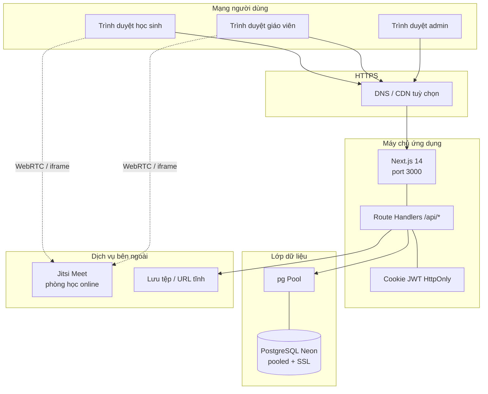

# Sơ đồ mạng máy tính

Mô tả kết nối logic khi chạy EduFlow (dev local hoặc triển khai).

## Môi trường phát triển / triển khai điển hình

## Luồng gói tin chính

1. Trình duyệt gửi cookie phiên tới `localhost:3000` (dev) hoặc origin HTTPS.
2. Next.js xử lý SSR/CSR; API đọc session, gọi Prisma qua `pg` adapter.
3. Neon yêu cầu TLS (`sslmode`); pool tối đa 10 kết nối trong `lib/prisma.ts`.
4. Buổi học online: EduFlow tạo `OnlineSession.roomCode`, client nối Jitsi — media không đi qua PostgreSQL.

## Phân đoạn bảo mật

| Vùng | Nội dung |
|------|----------|
| Client | UI React, không giữ mật khẩu sau login |
| App | JWT cookie, `requireAdmin` / kiểm tra enrollment |
| Data | Neon isolated; `.env` không commit |
| Media | Jitsi tách kênh audio/video |
