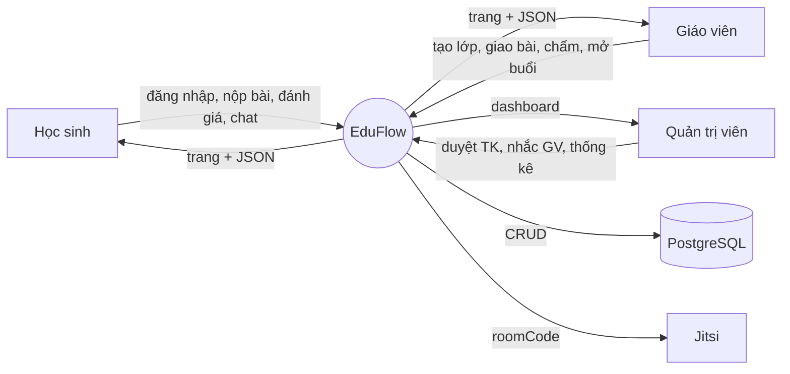
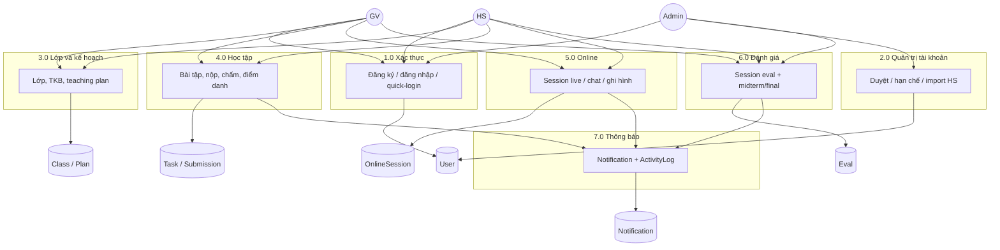

# Sơ đồ luồng dữ liệu (DFD)

## DFD mức 0 — ngữ cảnh

## DFD mức 1 — tiến trình

## Kho dữ liệu

| Ký hiệu | Bảng chính |
|---------|------------|
| D1 | `User`, `QuickLoginToken`, `PasswordResetToken` |
| D2 | `Class`, `ClassEnrollment`, `ScheduleSlot`, `TeachingPlanItem` |
| D3 | `Task`, `Submission`, `AttendanceRecord` |
| D4 | `OnlineSession`, `SessionMessage`, `ClassChat` |
| D5 | `SessionTeacherEval`, `CourseEvaluation` |
| D6 | `Notification`, `ActivityLog` |
