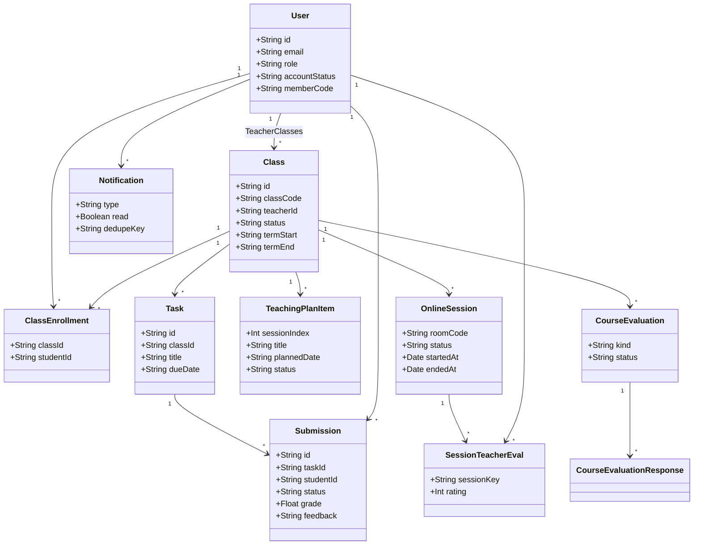

# Sơ đồ lớp (Class Diagram)

Các lớp miền chính tương ứng model Prisma và tầng server (`lib/server/*`).

## Tầng ứng dụng (không persist)

| Lớp / module | Trách nhiệm |
|--------------|-------------|
| `api` (`lib/api/client.ts`) | HTTP client typed |
| `prisma` proxy | PrismaClient lazy, chống HMR cũ |
| `getSession` | Đọc JWT cookie |
| Zustand stores | `authStore`, `eduStore`, `notificationStore` |
