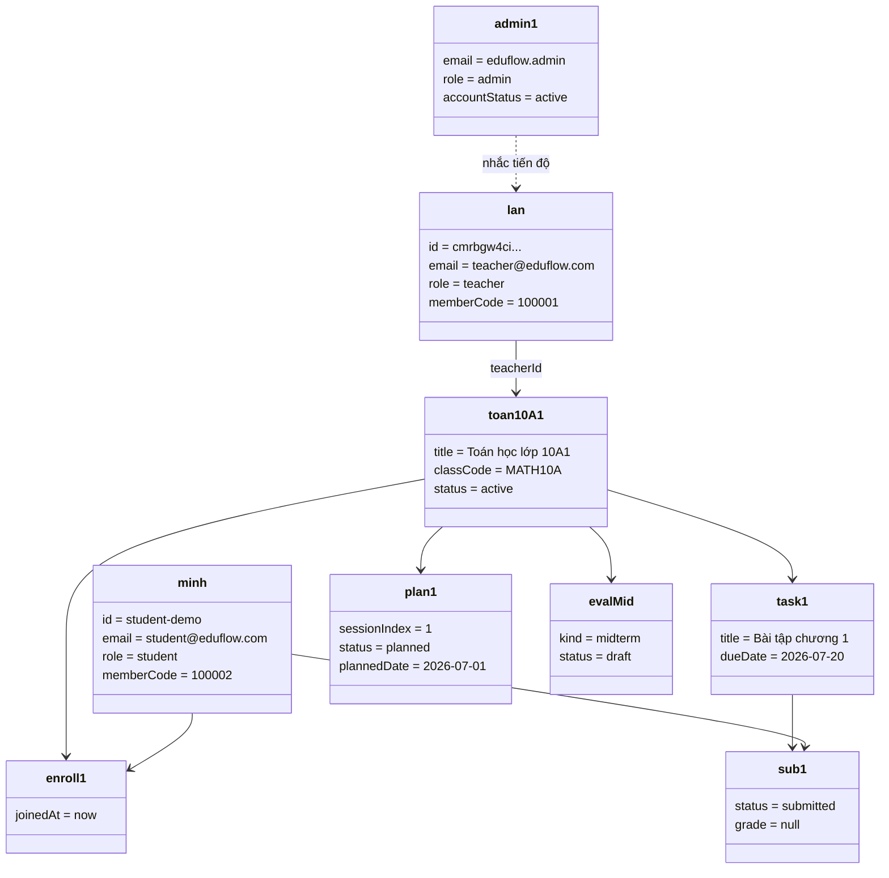

# Sơ đồ đối tượng (Object Diagram)

Ảnh chụp instance tại một thời điểm — ví dụ seed demo Toán 10A1.

## Ý nghĩa

Object diagram không thay ERD: nó cho thấy **một cấu hình cụ thể** (GV Lan, HS, lớp MATH10A, bài chưa chấm, kế hoạch buổi 1, đánh giá giữa kỳ còn `draft`).
