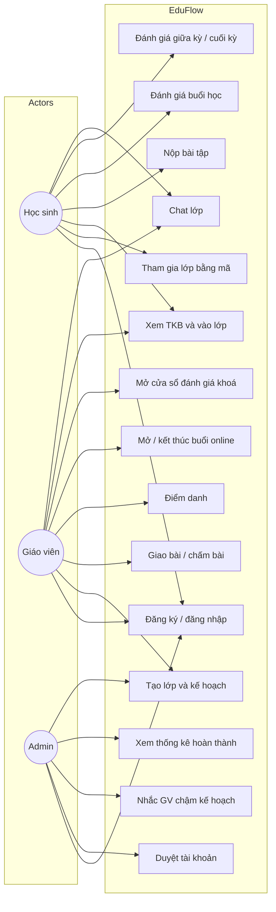

# Sơ đồ tình huống sử dụng (Use Case Diagram)

## Include / extend (rút gọn)

- **Nộp bài** include **đăng nhập** và **đã enroll**.
- **Kết thúc buổi online** extend **thông báo đánh giá buổi học**.
- **Nhắc GV** include **so sánh TeachingPlanItem với ngày hiện tại (Asia/Ho_Chi_Minh)**.
- **Mở đánh giá giữa kỳ** extend **gửi notification `course_eval`**.
