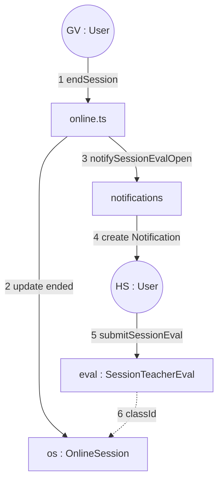

# Sơ đồ cộng tác và cấu trúc tổ hợp

Hai góc nhìn UML cho cùng hệ thống lớp học.

## Collaboration Diagram (UML 1.x)

Cộng tác: đối tượng + thông điệp đánh số (cùng kịch bản kết thúc buổi học).



## Composite Structure Diagram (UML 2)

Cấu trúc trong của “Lớp học” như một khối có cổng.

```mermaid
flowchart TB
  subgraph CLASS["Class (composite)"]
    T[part teacher : User]
    E[part enrollments : ClassEnrollment[*]]
    P[part plan : TeachingPlanItem[*]]
    S[part slots : ScheduleSlot[*]]
    O[part sessions : OnlineSession[*]]
    C[part chat : ClassChat]
    Q[part courseEvals : CourseEvaluation[2]]
  end

  portIn([port: join / teach])
  portOut([port: notify / stats])
  portIn --> E
  portIn --> T
  O --> portOut
  Q --> portOut
  C --> portOut
```

- **Cổng vào:** mã lớp, API roster, JWT role.
- **Cổng ra:** thông báo, thống kê admin (`work-stats`, `teaching-progress`).
