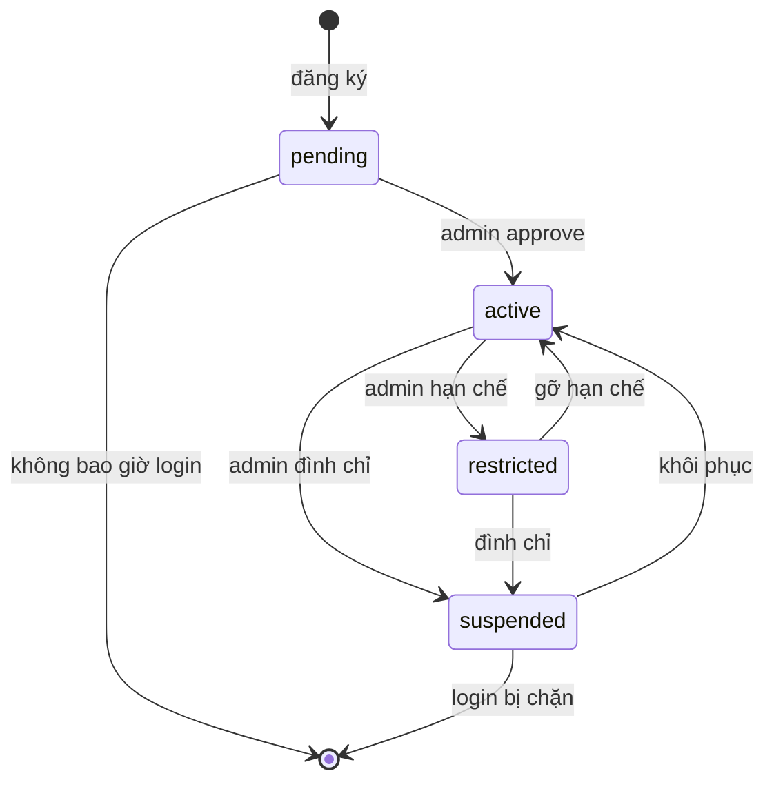
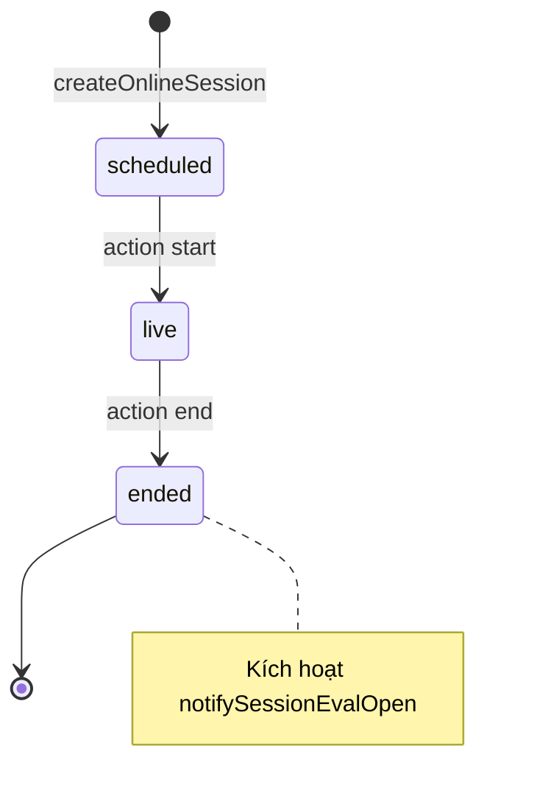
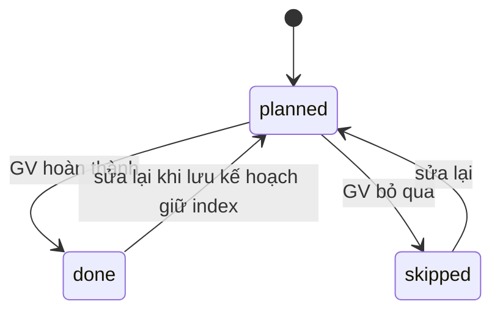
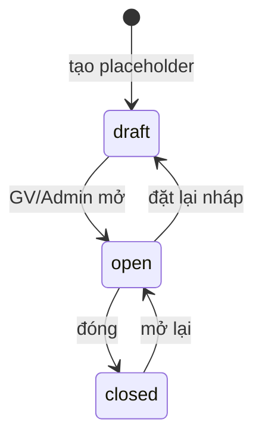
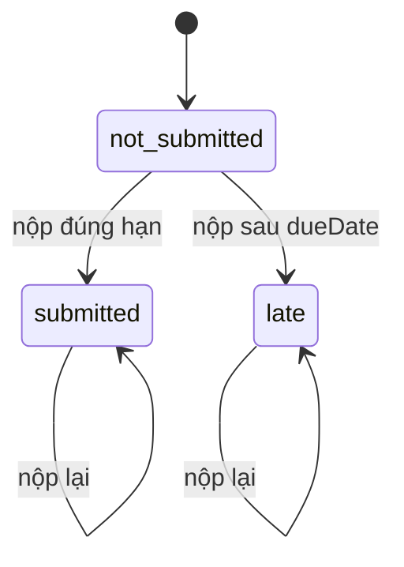

# Sơ đồ trạng thái (State Machine Diagram)

## Tài khoản `User.accountStatus`

## Buổi học `OnlineSession.status`

## Kế hoạch `TeachingPlanItem.status`

## Đánh giá khoá `CourseEvaluation.status`

## Bài nộp `Submission.status`

