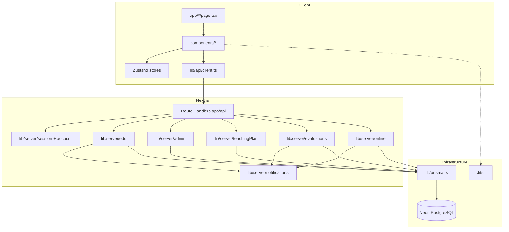

# Sơ đồ thành phần (Component Diagram)

## Thành phần giao diện nổi bật

| Component | Vai trò |
|-----------|---------|
| `DashboardShell` | Khung GV/HS |
| `AdminWorkCharts` | Thống kê hoàn thành, click → danh sách |
| `AdminTeachingMonitor` | Tiến độ kế hoạch + nhắc GV |
| `TeachingPlanPanel` | CRUD kế hoạch |
| `StudentEvalPanel` | Đánh giá buổi và khoá |
| `OnlineSessionPanel` | Tạo/start/end phòng |
| `NotificationBell` | Đọc thông báo |
