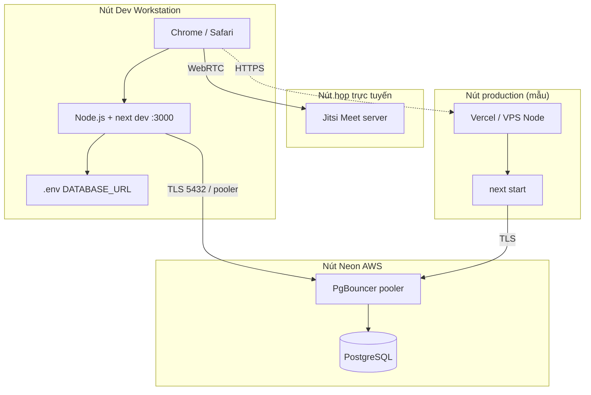

# Sơ đồ triển khai (Deployment Diagram)

## Artifact

| Artifact | Node |
|----------|------|
| Bundle Next.js (`.next`) | Workstation / Host |
| Prisma Client | cùng process Node |
| `migration.sql` | áp dụng lên Neon lúc `db:migrate:deploy` |
| Cookie JWT | trình duyệt, `HttpOnly` |

Hiện repo seed/dev mặc định trỏ Neon (`ep-*-pooler` us-east-1). Jitsi là dịch vụ ngoài, không lưu media trong Postgres.
