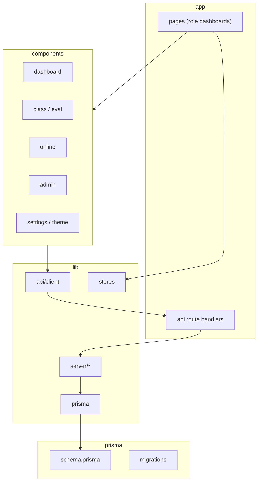

# Sơ đồ gói (Package Diagram)



## Phụ thuộc chiều

- `app` dùng `components` và `lib`, không ngược lại.
- `lib/server` không import React.
- `components` chỉ gọi `lib/api/client`, không gọi Prisma trực tiếp.

## Gói server chi tiết

```
lib/server
  account.ts        session.ts
  edu.ts            admin.ts
  schedule.ts       online.ts
  teachingPlan.ts   evaluations.ts
  notifications.ts  activityLog.ts
  classChat.ts      studentProgress.ts
  quickLogin.ts     passwordReset.ts
```
