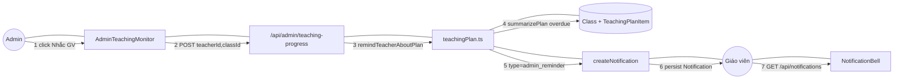

# Sơ đồ liên lạc (Communication Diagram)

Giống sequence nhưng nhấn mạnh liên kết đối tượng. Kịch bản: admin nhắc GV chậm kế hoạch.

## Thông điệp

| # | Từ | Đến | Nội dung |
|---|----|-----|----------|
| 1 | Admin | UI | Chọn lớp `behind` |
| 2 | UI | API | `{ teacherId, classId }` |
| 3–4 | Server | DB | Tính `overdue` theo ngày VN |
| 5–6 | Server | GV | `href=/teacher/courses/{id}?tab=plan` |
| 7 | GV | Bell | Đọc và đánh dấu đã đọc |
