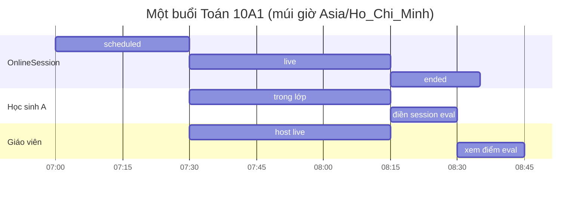

# Sơ đồ phối hợp thời gian (Timing Diagram — UML 2.0)

Trạng thái theo thời gian của một buổi học online và bài tập liên quan.

## Timeline buổi học + đánh giá



## Lifeline trạng thái (rút gọn UML Timing)

```
Đối tượng        07:00      07:30       08:15      08:30
OnlineSession    scheduled──live────────ended────────────────
HS.attendance    ──────────present───────────────────────────
SessionEval      ────────────────────────pending──submitted──
Notification     ────────────────────────unread───read───────
```

## Ràng buộc thời gian trong code

| Điều kiện | Thời điểm |
|-----------|-----------|
| Nộp đúng hạn | `submittedAt` ≤ `Task.dueDate` → `submitted` |
| Nộp muộn | sau `dueDate` → `late` |
| Plan overdue | `plannedDate < today` (VN) và `status=planned` |
| Session eval | chỉ khi `OnlineSession.status = ended` |
| Course eval | chỉ khi `CourseEvaluation.status = open` |
| Quick-login | `expiresAt`; revoke khi đổi mật khẩu |
